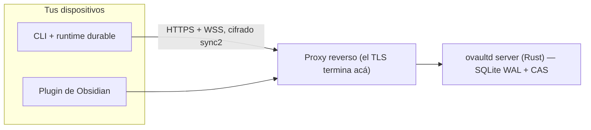

# ovaultd

Sync cifrado de punta a punta, self-hosted, para vaults de Obsidian. Tu servidor, tus claves: el server guarda blobs opacos y nunca ve qué hay adentro.

Paridad funcional con Obsidian Sync sobre infraestructura propia, construido alrededor de una spec de wire **congelada** (`v2`) y un protocolo cripto (`sync2`) que se verificó byte a byte entre Rust y JavaScript antes de implementar ninguno de los dos lados.

> El README principal (inglés) está en [README.md](README.md); esta es la versión en español. Las notas de diseño, los ADRs y los comentarios del código también están en español.

## Qué hace

- **Sync cifrado de archivos del vault** (add / mod / del / move) con revisiones y compare-and-swap (`expected_rev`): las ediciones que compiten se convierten en conflictos, no en pérdida silenciosa.
- **Subidas reanudables** (un subconjunto de tus) con cuotas por cuenta; una transferencia cortada resume desde el último offset confirmado.
- **Plano de control HTTP y plano de datos por WebSocket** para las deltas de revisión.
- **Paths cifrados y registros de revisión firmados** (Ed25519, encadenados por `expected_rev`): si el server manipula algo, los clientes lo detectan.
- **Un solo contenedor endurecido**: uid non-root, rootfs de solo lectura, sin capabilities, SQLite WAL y almacén de blobs content-addressed bajo `/data`.
- **Listo para detrás de un borde**: el server publica en loopback y habla HTTP plano; `docs/deploy.md` documenta exactamente qué tiene que respetar el borde (Nginx Proxy Manager, nginx, Caddy). El repo no trae proxy — el borde es del operador (ADR-0019).
- **Panel web de administración**: cuentas con roles (crear, deshabilitar, promover o degradar, links de restablecimiento de un solo uso, borrado de cuenta con purga de sus vaults), vaults con detalle por vault y borrado, dispositivos con revocación en un click, auditoría paginada con filtro, ajustes del server (abrir o cerrar el registro) y cambio de password propio. Server-rendered con assets embebidos, CSRF en cada POST, sin JS obligatorio: anda en la LAN o detrás del borde.
- **Sin registro público.** La primera cuenta se crea por la web en `/setup` (solo el primer arranque, ADR-0016); las siguientes, desde el panel o con el CLI de administración que viene dentro de la imagen (ADR-0011).
- **Stack de cliente completo**: un núcleo durable offline (estado versionado, outbox save-first, journal de aplicación), un CLI (`login`, `create-remote`, `setup`, `sync --continuous`, …) y un plugin de Obsidian que corre ese mismo núcleo dentro del editor — sync por eventos, resolución explícita de conflictos, gestión de llaves del vault (recuperar con la recovery key, cambiar la password) y export/import del vault.
- **Herramientas de operación**: `backup.sh` / `restore.sh` con verificación por checksums, pruebas de crash con abortos de proceso reales, y una canaria que escanea el almacenamiento crudo buscando plaintext.

Todo lo que figura arriba está respaldado por gates de ejecución real, no mocks: suites de unidad e integración en Rust, suites de TypeScript, specs de durabilidad de browser contra un Chromium real, un smoke completo del server con cripto viva y tráfico WebSocket, y un E2E de contenedor que construye la imagen real y verifica la persistencia tras un recreate.

## Cómo funciona



El server persiste blobs cifrados, registros de revisión firmados y metadatos de cuentas. Tus claves derivan de tu password y de la recovery key, y no salen de tus dispositivos. Los registros de revisión están firmados por las claves de cada device y encadenados por `expected_rev`: si el server manipula algo, los clientes lo detectan.

| Path | Qué es |
|---|---|
| `crates/ovaultd-server` | el server (axum, tokio, sqlx; migraciones embebidas en el binario) |
| `crates/ovaultd-crypto` | implementación Rust de `sync2`, usada en tests y en el spike de interop |
| `crates/ovaultd-protocol` | tipos del wire compartidos por ambos lados |
| `packages/protocol` | el contrato del wire en TypeScript (tipos, base64 estricto, serialización canónica) |
| `packages/crypto` | `sync2` en TypeScript, port byte-fiel del spike |
| `packages/core` | núcleo durable del cliente: estado IndexedDB versionado, outbox save-first, journal de aplicación, sesión de sync (WS + HTTP) y reconciliación de bajada |
| `packages/cli` | `login`, `create-remote`, `setup`, `list-remote`, `status`, `list-local`, `sync` (+ `--continuous`), `config`, `unlink` + el runtime durable en Chromium |
| `spikes/crypto-interop` | el spike Rust ⇄ JS y la maquinaria de congelamiento de vectores |
| `tests/` | specs de browser, fixtures congelados, scripts de smoke / canaria / E2E de contenedor |
| `scripts/` | herramientas de operación: `backup.sh`, `restore.sh`, el escáner de fugas que corre antes de cada push |
| `docs/` | especificaciones de protocolo y cripto, ADRs, guía de deploy, runbook |
| `xtask/` | tareas del repo (`cargo xtask protocol-check`, `cargo xtask backup-restore`) |

El plugin de Obsidian vive en su propio repositorio: [github.com/kastormdz/ovaultd-plugin](https://github.com/kastormdz/ovaultd-plugin).

## Modelo de seguridad

Todo lo que importa pasa en tu dispositivo.

- Tu password se estira con Argon2id a una KEK, y la vault key se envuelve con ella (y con una recovery key que se muestra exactamente una vez).
- El contenido se cifra con XChaCha20-Poly1305 bajo claves por vault y por contenido. El nonce se deriva del plaintext y viaja dentro del blob almacenado, así el cliente puede descifrar después sin ayuda del server (ADR-0014).
- Los `blob_id` son SHA-256 de los bytes **almacenados** (cifrados). Contenido idéntico deduplica dentro del vault y, como la derivación del nonce es keyed, la deduplicación no es un oráculo externo.
- Los paths también van cifrados; el server los guarda como IDs opacos más ciphertext.
- Los registros de revisión van firmados (Ed25519) y encadenados por `expected_rev`.

Qué puede ver el server: el email de la cuenta, los nombres de los devices, los números de revisión, tamaños y hashes de blobs, y metadatos de tiempos. Qué no puede ver: contenido, paths, claves, ni tu password. El detalle está en `docs/crypto.md` y `docs/decisions/`.

## Puesta en marcha

### 1. Levantar el server

```bash
git clone https://github.com/kastormdz/ovaultd && cd ovaultd
cp .env.example .env

# construye la imagen local
docker compose -f compose.yaml -f docker/compose.dev.yaml up -d --build

curl --fail http://127.0.0.1:8080/healthz   # directo al server
```

Para correr una imagen ya publicada, seteá `OVAULTD_IMAGE` con un digest real `repositorio@sha256:...` y sacá el overlay de desarrollo: `docker compose -f compose.yaml up -d`.

### 2. Crear tu cuenta

La **primera** cuenta se crea desde el navegador: abrí `http://127.0.0.1:8080/setup`. Esa página existe solo mientras el servidor no tenga ninguna cuenta y se desactiva al crearla — no hay registro público (ADR-0011/0016). Si el server puede quedar expuesto antes de completarla, seteá `OVAULTD_SETUP_TOKEN`.

Para las cuentas **siguientes** (otra persona — una segunda laptop es solo otro dispositivo, y se suma con `login`), un admin las crea desde el panel, o se usa el CLI de administración que viene dentro de la imagen:

```bash
printf '%s\n' 'una-password-larga' | docker compose exec -T ovaultd \
  ovaultd-admin create-account --email otro@ejemplo.com
```

La password se lee **siempre** de stdin, nunca como argumento. `ovaultd-admin` también responde `health` e `inspect` sin descifrar nada.

### 3. Primer vault, desde el CLI

```bash
npm install
npm run build

printf '%s\n' 'una-password-larga' | node packages/cli/dist/main.js \
  login http://127.0.0.1:8080 --email vos@ejemplo.com --password-stdin

node packages/cli/dist/main.js create-remote mi-vault
# imprime la recovery key UNA vez — guardala en un lugar seguro.
# Para scripts: --recovery-out <archivo> la escribe con permisos 0600.

node packages/cli/dist/main.js status
```

`create-remote` genera el material del vault. `setup` vincula una carpeta local a un vault remoto existente y verifica tu password contra el material. `list-remote` muestra lo que la cuenta tiene.

### 4. O desde Obsidian

Instalá el [plugin](https://github.com/kastormdz/ovaultd-plugin) y vinculalo desde sus ajustes: URL del server, email y password de la cuenta (una sola vez), y después elegí tu vault de la lista — o creá uno nuevo ahí mismo. De ahí en más el sync es por eventos y no pide nada más.

## Detrás de un proxy reverso

El contenedor publica en loopback y habla HTTP plano; el TLS es del proxy. Tres cosas que el proxy tiene que hacer bien (ejemplos para nginx, Nginx Proxy Manager y Caddy en `docs/deploy.md`):

1. **Preservar el `Host`.** Los clientes aprenden el host del server desde `POST /access`; si el proxy lo reescribe, guardan una URL que después no resuelve.
2. **Permitir el upgrade de WebSocket** en `/api/v1/ws`, con timeouts de lectura largos.
3. **Subir el límite de body a 40 MB y desactivar el buffering de request.** Los bloques de subida reanudable llegan hasta 32 MiB, y el default de nginx (1 MB) los corta con 413.

## Compatibilidad

Server y plugin viajan en un **release train**: el mismo `MAJOR.MINOR` de los dos lados es una pareja probada junta. Los patches son independientes: el `0.2.5` del server anda con el `0.2.1` del plugin.

| Server | Plugin | Wire |
|---|---|---|
| `0.2.x` | `0.2.x` | `v2` |

`GET /api/v1/meta` es el contrato detrás de esa tabla, y es público a propósito: cada cliente lo lee **antes** de vincular cualquier cosa y recibe la versión del server, la del wire, el plugin mínimo que acepta y la lista de features. Un plugin más viejo que `min_plugin_version` se niega a vincular (con un mensaje que apunta al plugin, no al server), y una versión de wire distinta también — en ningún caso queda algo a medio escribir.

## Releases

Las releases se cortan con un tag. `server-vX.Y.Z` corre los gates completos — suites TypeScript, suites Rust, el smoke del server (cripto viva y WebSocket) y la canaria de cifrado — después construye un binario estático `x86_64-unknown-linux-musl` más `ovaultd-admin`, publica la imagen del contenedor en GHCR (`X.Y.Z` y `latest`) y adjunta el tar.gz con su `SHA256SUMS` a la GitHub Release. El tag **es** la versión declarada: si `Cargo.toml` no coincide, el workflow falla antes de publicar nada.

```bash
tar xzf ovaultd-0.2.0-x86_64-unknown-linux-musl.tar.gz
sha256sum -c SHA256SUMS
OVAULTD_BIND=127.0.0.1:8080 OVAULTD_DB=./datos/metadata.db OVAULTD_CAS=./datos/cas ./ovaultd
```

O la imagen, que es la vía de despliegue que el proyecto apunta:

```bash
docker run -d --name ovaultd -p 127.0.0.1:8080:8080 -v ovaultd-data:/data \
  ghcr.io/kastormdz/ovaultd:0.2.0
```

Lo que cambió en cada versión vive en [CHANGELOG.md](CHANGELOG.md), y las notas de la release salen de ahí — nunca de prosa generada.

## Desarrollo

```bash
npm install
npm run build            # paquetes TS + el bundle del runtime del núcleo
npm test                 # suites TS (vectores cripto, conformidad del wire, CLI)
npm run test:browser     # specs de durabilidad contra un Chromium real
cargo test --workspace   # suites Rust
cargo xtask protocol-check          # el MISMO fixture de conformidad, en ambos lados
bash tests/scripts/server-smoke.sh  # flujo completo del server, cripto viva + WebSocket
bash tests/scripts/scan-canary.sh   # nada de plaintext en el almacenamiento del server
bash tests/scripts/container-e2e.sh # todo: build real + smoke + persistencia
(cd spikes/crypto-interop && ./run.sh --check)   # interop contra los vectores congelados
```

Reglas que vale la pena conocer:

- La spec se congela antes de codear. Un cambio de protocolo o cripto aterriza como un ADR nuevo, nunca como un edit silencioso.
- Los vectores dorados se regeneran solo por la vía sancionada (`run.sh --freeze`), después de revisar, y jamás en CI. El fixture de conformidad del protocolo lo ejecutan Rust y TS: ese es el gate anti-drift.
- `scripts/scan-leaks.sh` revisa que no se cuelen datos de infraestructura o credenciales, en el árbol y en la historia. Los patrones personales (tus hostnames, usuarios, subredes) van en `scripts/leaks.local`, que no se versiona — ver `scripts/leaks.local.example`. Para activarlo como hook de pre-commit: `git config core.hooksPath .githooks`.

## Documentación

- `docs/protocol.md` — protocolo de wire v2 (control, plano de datos, algoritmos)
- `docs/crypto.md` — la spec cripto `sync2` + vectores dorados
- `docs/server-interfaces.md` — el contrato del server
- `docs/deploy.md` — Docker y proxy reverso, backups
- `docs/runbook.md` — operar un server: backups, restore, recuperación
- `docs/decisions/` — registros de decisión de arquitectura

## Licencia

El server y los crates de Rust están bajo AGPL-3.0 (`LICENSE`). Los paquetes TypeScript de `packages/` son MIT, y cada uno trae su propio `LICENSE`. El plugin de Obsidian también es MIT, en su propio repositorio.
