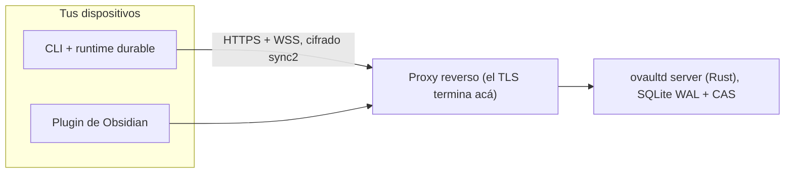
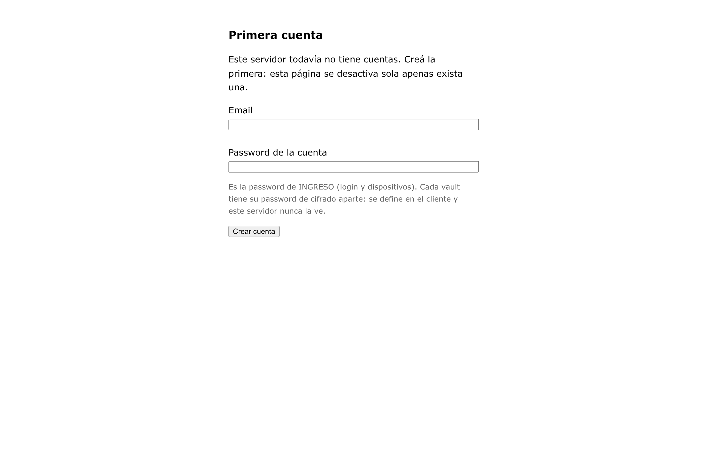
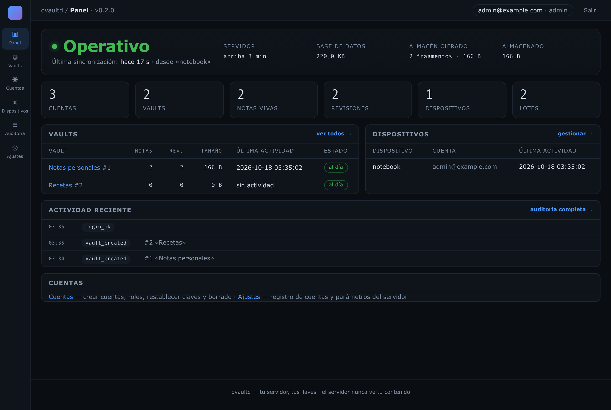
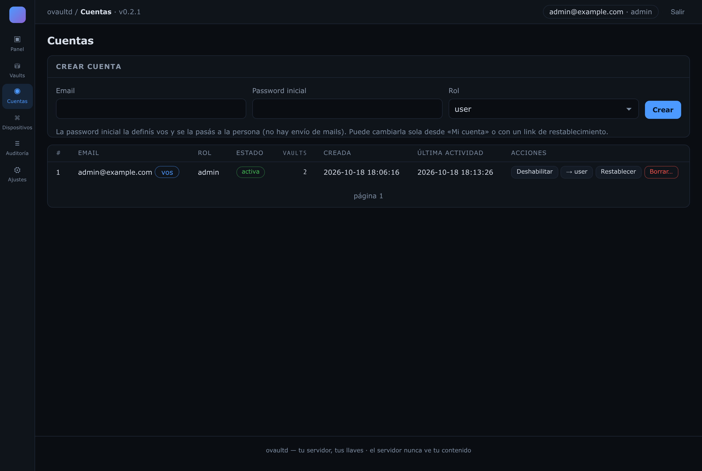

# ovaultd

Guardo mis notas en Obsidian y las guardo en hardware mío. ovaultd es el server de sync que hace que las dos cosas sean verdad al mismo tiempo.

Obsidian Sync es un buen producto. También corre en servidores de otro, y "prometemos no mirar" no es lo mismo que "no podemos mirar". Así que armé la versión que quería: un contenedor, un plugin, un CLI, y un server que guarda blobs cifrados que no tiene forma de abrir. El server sabe tu email, los nombres de tus dispositivos y cuánto pesan tus archivos. No sabe tus notas, ni tus paths, ni tu password, ni tus claves. Eso no es una línea en una política de privacidad: es lo que el protocolo puede transportar.

Las notas de diseño, los ADRs y los comentarios del código están en español, porque es el idioma en el que pienso. Esta es la versión en español; el README principal está en [README.md](README.md).

## Qué ve realmente el server

| Ve | No puede ver |
|---|---|
| email de la cuenta, nombres de dispositivos, números de revisión | contenido de los archivos |
| tamaños y hashes de blobs, timestamps | paths (van cifrados, guardados como IDs opacos) |
| metadatos de cuentas y vaults | tu password, la vault key y las claves de firma |

El resto es aritmética. Tu password pasa por Argon2id hasta una KEK, que desenvuelve la vault key. De ahí salen claves por contenido para XChaCha20-Poly1305 y claves Ed25519 para firmar. Cada registro de revisión va firmado y encadenado por `expected_rev`, así que un server que reescribe la historia queda en evidencia con el próximo cliente que mire. Los IDs de blob son SHA-256 de los bytes cifrados: eso deduplica dentro de un vault sin filtrar si dos vaults guardan el mismo archivo.

El login está frenado a 5 intentos por minuto por `ip+email`, y los intentos contra cuentas inexistentes también cuentan, así que el password spraying muere igual. Los headers de proxy se obedecen solo si declarás el borde con `OVAULTD_TRUST_PROXY=1`; por defecto la IP del cliente es la del peer TCP real, que un cliente no puede falsear.

## Cómo se mueve



Las bajadas son deltas desde tu última revisión conocida. Las subidas son bloques reanudables (un subconjunto de tus) con cuota por cuenta, así que una transferencia cortada sigue desde el último offset confirmado en vez de empezar de cero. El control va por HTTP; las deltas de revisión, por WebSocket.

## Las partes

| Path | Qué es |
|---|---|
| `crates/ovaultd-server` | el server (axum, tokio, sqlx; migraciones embebidas en el binario) |
| `crates/ovaultd-crypto` | implementación Rust de `sync2`, usada en tests y en el spike de interop |
| `crates/ovaultd-protocol` | tipos del wire compartidos por ambos lados |
| `packages/protocol` | el contrato del wire en TypeScript: tipos, base64 estricto, serialización canónica |
| `packages/crypto` | `sync2` en TypeScript, port byte a byte del lado Rust |
| `packages/core` | el núcleo durable del cliente: estado en IndexedDB, outbox save-first, journal de aplicación, sesión de sync |
| `packages/cli` | el comando `ovaultd`, más el runtime de Chromium que hospeda el núcleo |
| `spikes/crypto-interop` | el spike de interop Rust/JS y la maquinaria de congelamiento de vectores |
| `tests/` | specs de browser, fixtures congelados, scripts de smoke, canaria y E2E de contenedor |
| `scripts/` | `backup.sh`, `restore.sh` y el escáner de fugas que corre antes de cada push |
| `docs/` | specs de protocolo y cripto, ADRs, guía de deploy, runbook |
| `xtask/` | tareas del repo: `cargo xtask protocol-check`, `cargo xtask backup-restore` |

El plugin vive en [su propio repositorio](https://github.com/kastormdz/ovaultd-plugin) porque el directorio de la comunidad pide el manifest y los assets de release en la raíz del repo que se somete. Está publicado como **[oVaultd Sync](https://community.obsidian.md/plugins/ovaultd)**, así que se instala desde el propio Obsidian (Ajustes, Complementos comunitarios, Explorar).

## Ponerlo a andar

### 1. El server

```bash
git clone https://github.com/kastormdz/ovaultd && cd ovaultd
cp .env.example .env

# construye la imagen local
docker compose -f compose.yaml -f docker/compose.dev.yaml up -d --build

curl --fail http://127.0.0.1:8080/healthz
```

Para correr una imagen publicada, pineá un digest real en `OVAULTD_IMAGE` y sacá el overlay de desarrollo: `docker compose -f compose.yaml up -d`.

### 2. Tu cuenta

La primera cuenta se crea desde el navegador y nace admin. `/setup` existe solo mientras el server no tenga ninguna cuenta; apenas hay una, la página se desactiva sola. No hay registro público, y es a propósito.



Si el server puede quedar al alcance antes de que termines este paso, seteá `OVAULTD_SETUP_TOKEN` y la página va a pedir además `?token=...`.

Después, tu casa es el panel en `/admin`:



Las cuentas siguientes también salen de ahí. Entrás a **Cuentas**, completás email, password inicial y rol, y le pasás la password a la persona vos mismo, porque no hay envío de mails:



Ese mismo panel cambia roles, deshabilita cuentas, emite links de restablecimiento de un solo uso, borra una cuenta con sus vaults, revoca dispositivos y deja todo en **Auditoría**. Una segunda laptop no es una cuenta nueva: es otro dispositivo de la misma cuenta, y se suma ingresando desde ahí. `ovaultd-admin` sigue existiendo dentro de la imagen como camino de emergencia para cuando no hay un navegador a mano.

<sub>Las capturas son de un servidor de demostración descartable: ahí todas las cuentas son `@example.com`.</sub>

### 3. Tu vault

Abrí los ajustes del plugin, entrá con tu cuenta y creá el vault: un nombre y una password de cifrado que inventás vos. La recovery key se muestra exactamente una vez, así que guardala en un lugar que no sea un papelito pegado al monitor. Ese es todo el flujo: el plugin corre el mismo núcleo cripto que todo lo demás.

### El CLI, para servidores y scripts

El plugin es lo que uso yo. El CLI es lo que usan mi server y mis agentes, y maneja el mismo núcleo. No está en npm, así que se instala desde el checkout:

```bash
npm install
npm run build
bash scripts/instalar-cli.sh            # -> ~/.local/bin/ovaultd

ovaultd login https://obs.example.com --email vos@ejemplo.com
ovaultd list-remote
ovaultd setup <ID> --dir ~/Obsidian     # pide la password del vault una vez
ovaultd sync
```

`create-remote` genera el material del vault. `setup` vincula una carpeta local a un vault remoto existente y verifica tu password contra ese material. `list-remote` muestra lo que la cuenta tiene.

Con la carpeta vinculada, `ovaultd cat`, `write`, `ls` y `rm` trabajan sobre el vault descifrado, con los paths confinados a él, y `sync` publica los cambios como revisiones firmadas. Para mantenerlo al día sin TTY, corré el sync continuo como servicio de usuario de systemd:

```bash
mkdir -p ~/.config/systemd/user
cp contrib/systemd/ovaultd-sync.service ~/.config/systemd/user/
systemctl --user daemon-reload
systemctl --user enable --now ovaultd-sync
loginctl enable-linger "$USER"
journalctl --user -u ovaultd-sync -f
```

El primer `sync` cachea las subclaves derivadas con permisos 0600, así el servicio nunca necesita la password; `ovaultd olvidar-clave` borra el cache. Referencia completa: [docs/cli.md](docs/cli.md). Playbook para agentes: `skills/ovaultd-cli/SKILL.md`.

## Detrás de un proxy reverso

El contenedor escucha en loopback y habla HTTP plano. El TLS es del proxy, y el repo no trae proxy a propósito: el borde es tuyo (ADR-0019). Cuatro cosas que el proxy tiene que hacer bien, con ejemplos para nginx, Nginx Proxy Manager y Caddy en [docs/deploy.md](docs/deploy.md):

1. Preservar el `Host`. Los clientes aprenden el host del server desde `POST /access`; si el proxy lo reescribe, guardan una dirección que después no funciona.
2. Permitir el upgrade de WebSocket en `/api/v1/ws`, con timeouts de lectura largos.
3. Subir el límite de body a 40 MB y desactivar el buffering de request. Los bloques reanudables llegan a 32 MiB, y el default de 1 MB de nginx los corta con un 413.
4. Setear `OVAULTD_TRUST_PROXY=1` solo si el proxy está realmente adelante. Con eso, el server cree en los headers de identidad; sin eso, usa el peer TCP.

## Versiones

Server y plugin viajan en un release train: el mismo `MAJOR.MINOR` de los dos lados es una pareja probada junta, y los patches son independientes. El server `0.2.3` anda con el plugin `0.2.13`.

| Server | Plugin | Wire |
|---|---|---|
| `0.2.x` | `0.2.x` | `v2` |

`GET /api/v1/meta` es el contrato detrás de esa tabla, y es público a propósito. Cada cliente lo lee antes de vincular nada: versión del server, versión del wire, plugin mínimo, lista de features. Un plugin más viejo que `min_plugin_version` se niega a vincular con un mensaje que apunta al plugin, no al server. Una versión de wire distinta también se niega. En ningún caso queda algo a medio escribir.

## Releases

Una release es un tag. `server-vX.Y.Z` corre los gates (TypeScript, Rust, el smoke del server con cripto viva y WebSocket, la canaria de cifrado), construye un binario estático `x86_64-unknown-linux-musl` más `ovaultd-admin`, publica la imagen en GHCR como `X.Y.Z` y `latest`, y adjunta el tarball con su `SHA256SUMS`. El tag es la versión declarada: si `Cargo.toml` no coincide, el workflow falla antes de publicar nada.

```bash
tar xzf ovaultd-0.2.11-x86_64-unknown-linux-musl.tar.gz
sha256sum -c SHA256SUMS
OVAULTD_BIND=127.0.0.1:8080 OVAULTD_DB=./datos/metadata.db OVAULTD_CAS=./datos/cas ./ovaultd
```

O la imagen, que es la vía que este proyecto apunta:

```bash
docker run -d --name ovaultd -p 127.0.0.1:8080:8080 -v ovaultd-data:/data \
  ghcr.io/kastormdz/ovaultd:0.2.11
```

La imagen de GHCR es exactamente el digest que verificó el E2E. La release la re-taggea en vez de reconstruirla, así que lo que bajás es lo que se probó.

Lo que cambió en cada versión vive en [CHANGELOG.md](CHANGELOG.md), y las notas de release se copian de ahí en vez de generarse.

## Documentación

- [docs/protocol.md](docs/protocol.md): protocolo de wire v2, control y plano de datos
- [docs/crypto.md](docs/crypto.md): la spec `sync2` y los vectores dorados
- [docs/server-interfaces.md](docs/server-interfaces.md): el contrato del server
- [docs/deploy.md](docs/deploy.md): Docker, proxy reverso, backups
- [docs/cli.md](docs/cli.md): el CLI, desde la instalación hasta el historial de notas
- [docs/development.md](docs/development.md): compilar, testear, reglas de contribución
- [docs/runbook.md](docs/runbook.md): operar un server, backups, restore, recuperación
- [docs/decisions/](docs/decisions/): registros de decisión de arquitectura

## Licencia

El server y los crates de Rust son AGPL-3.0 (`LICENSE`). Los paquetes TypeScript de `packages/` son MIT, cada uno con su propio `LICENSE`. El plugin de Obsidian también es MIT, en su propio repositorio.
