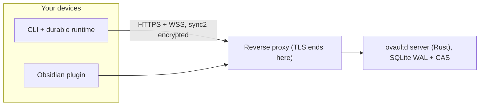

# ovaultd

I keep my notes in Obsidian and I keep them on hardware I own. ovaultd is the sync server that makes both true at the same time.

Obsidian Sync is a good product. It also runs on someone else's servers, and "we promise not to look" is not the same as "we can't look". So I built the version I wanted: one container, one plugin, one CLI, and a server that stores encrypted blobs it has no way to open. The server knows your email, your device names and how big your files are. It does not know your notes, your paths, your password or your keys. That is not a line in a privacy policy. It is what the wire protocol can carry.

Design notes, ADRs and code comments are in Spanish, because that is the language I think in. This is the English entry point; there is a [Spanish version](README.es.md).

## What the server actually sees

| It sees | It cannot see |
|---|---|
| account email, device names, revision numbers | file contents |
| blob sizes, hashes, timestamps | file paths (encrypted, stored as opaque IDs) |
| account and vault metadata | your password, vault key and signing keys |

The rest is arithmetic. Your password goes through Argon2id into a KEK, which unwraps the vault key. From there: per-content keys for XChaCha20-Poly1305, and Ed25519 keys for signatures. Every revision record is signed and chained by `expected_rev`, so a server that rewrites history gets caught by the next client that looks. Blob IDs are SHA-256 of the encrypted bytes, which deduplicates inside a vault without leaking whether two vaults hold the same file.

Login is rate limited at 5 attempts per minute per `ip+email`, and attempts against accounts that do not exist count too, so password spraying dies the same way. Proxy headers are only honored when you declare a trusted edge with `OVAULTD_TRUST_PROXY=1`; by default the client IP is the real TCP peer, which a client cannot forge.

## How it moves



Downloads are deltas since your last known revision. Uploads are resumable blocks (a subset of tus) with a quota per account, so an interrupted transfer picks up at the last acknowledged offset instead of starting over. Control traffic is HTTP; revision deltas ride a WebSocket.

## The parts

| Path | What it is |
|---|---|
| `crates/ovaultd-server` | the server (axum, tokio, sqlx; migrations embedded in the binary) |
| `crates/ovaultd-crypto` | Rust implementation of `sync2`, used in tests and the interop spike |
| `crates/ovaultd-protocol` | wire types shared by both sides |
| `packages/protocol` | the wire contract in TypeScript: types, strict base64, canonical serialization |
| `packages/crypto` | `sync2` in TypeScript, a byte-faithful port of the Rust side |
| `packages/core` | the durable client core: IndexedDB state, save-first outbox, apply journal, sync session |
| `packages/cli` | the `ovaultd` command, plus the Chromium runtime that hosts the core |
| `spikes/crypto-interop` | the Rust/JS interop spike and the golden-vector freeze tooling |
| `tests/` | browser specs, frozen fixtures, smoke, canary and container E2E scripts |
| `scripts/` | `backup.sh`, `restore.sh`, and the leak scanner that runs before every push |
| `docs/` | protocol and crypto specs, ADRs, deploy guide, runbook |
| `xtask/` | repo tasks: `cargo xtask protocol-check`, `cargo xtask backup-restore` |

The plugin lives in [its own repository](https://github.com/kastormdz/ovaultd-plugin) because the community directory wants the manifest and the release assets at the root of the submitted repo. It is published as **[oVaultd Sync](https://community.obsidian.md/plugins/ovaultd)**, so you can install it from inside Obsidian (Settings, Community plugins, Browse).

## Getting it running

### 1. The server

```bash
git clone https://github.com/kastormdz/ovaultd && cd ovaultd
cp .env.example .env

# builds the image locally
docker compose -f compose.yaml -f docker/compose.dev.yaml up -d --build

curl --fail http://127.0.0.1:8080/healthz
```

To run a published image instead, pin a real digest in `OVAULTD_IMAGE` and drop the dev overlay: `docker compose -f compose.yaml up -d`.

### 2. Your account

The first account is created in the browser and it is born admin. `/setup` only exists while the server has zero accounts; the moment one exists, that page disables itself. There is no public registration, and that is on purpose.


If the server may be reachable before you finish this step, set `OVAULTD_SETUP_TOKEN` and the page will also ask for `?token=...`.

After that, your home is the panel at `/admin`:


Every further account comes from there too. Open **Cuentas**, fill in an email, an initial password and a role, then hand the password over yourself, because there is no email delivery:


The same panel changes roles, disables accounts, issues one-shot password reset links, deletes an account with its vaults, revokes devices, and writes all of it to **Auditoría**. A second laptop is not a new account; it is another device of the same account and it joins by signing in from there. `ovaultd-admin` still exists inside the image as the break-glass path when there is no browser around.

<sub>Screenshots come from a throwaway demo server: every account there is `@example.com`.</sub>

### 3. Your vault

Open the plugin settings, sign in, create the vault: a name and a vault password you invent. The recovery key is shown exactly once, so store it somewhere that is not a sticky note. That is the whole flow. The plugin runs the same crypto core as everything else.

### The CLI, for servers and scripts

The plugin is what I use. The CLI is what my server and my agents use, and it drives the same core. It is not on npm, so install it from the checkout:

```bash
npm install
npm run build
bash scripts/instalar-cli.sh            # -> ~/.local/bin/ovaultd

ovaultd login https://obs.example.com --email you@example.com
ovaultd list-remote
ovaultd setup <ID> --dir ~/Obsidian     # asks the vault password once
ovaultd sync
```

`create-remote` generates the vault material. `setup` links a local folder to an existing remote vault and checks the password against that material. `list-remote` shows what the account owns.

With the folder linked, `ovaultd cat`, `write`, `ls` and `rm` work on the decrypted vault, with paths confined to it, and `sync` publishes the changes as signed revisions. To keep it current without a TTY, run the continuous sync as a systemd user service:

```bash
mkdir -p ~/.config/systemd/user
cp contrib/systemd/ovaultd-sync.service ~/.config/systemd/user/
systemctl --user daemon-reload
systemctl --user enable --now ovaultd-sync
loginctl enable-linger "$USER"
journalctl --user -u ovaultd-sync -f
```

The first `sync` caches the derived vault subkeys with mode 0600, so the service never needs the password; `ovaultd olvidar-clave` drops the cache. Full reference: [docs/cli.md](docs/cli.md). Agent playbook: `skills/ovaultd-cli/SKILL.md`.

## Behind a reverse proxy

The container listens on loopback and speaks plain HTTP. TLS belongs to the proxy, and the repo ships no proxy on purpose: the edge is yours (ADR-0019). Four things it has to get right, with examples for nginx, Nginx Proxy Manager and Caddy in [docs/deploy.md](docs/deploy.md):

1. Keep `Host`. Clients learn the server host from `POST /access`; a rewritten Host makes them store an address that does not work.
2. Allow WebSocket upgrades on `/api/v1/ws`, with long read timeouts.
3. Raise the body limit to 40 MB and disable request buffering. Resumable blocks go up to 32 MiB, and nginx's 1 MB default kills them with a 413.
4. Set `OVAULTD_TRUST_PROXY=1` only if the proxy is really in front. With it set, the server believes the identity headers; without it, it uses the TCP peer.

## Versions

Server and plugin travel on a release train: the same `MAJOR.MINOR` on both sides is a pair that was tested together, and patches are independent. Server `0.2.3` works with plugin `0.2.13`.

| Server | Plugin | Wire |
|---|---|---|
| `0.2.x` | `0.2.x` | `v2` |

`GET /api/v1/meta` is the contract behind that table, and it is public on purpose. Every client reads it before linking anything: server version, wire version, minimum plugin, feature list. A plugin older than `min_plugin_version` refuses with a message that points at the plugin, not at the server. An older wire version refuses too. Nothing is half-written in either case.

## Releases

A release is a tag. `server-vX.Y.Z` runs the gates (TypeScript, Rust, the server smoke test with live crypto and WebSocket, the encryption canary), builds a static `x86_64-unknown-linux-musl` binary plus `ovaultd-admin`, publishes the image to GHCR as `X.Y.Z` and `latest`, and attaches the tarball with its `SHA256SUMS`. The tag is the declared version: if `Cargo.toml` disagrees, the workflow fails before publishing anything.

```bash
tar xzf ovaultd-0.2.11-x86_64-unknown-linux-musl.tar.gz
sha256sum -c SHA256SUMS
OVAULTD_BIND=127.0.0.1:8080 OVAULTD_DB=./datos/metadata.db OVAULTD_CAS=./datos/cas ./ovaultd
```

Or the image, which is the path this project targets:

```bash
docker run -d --name ovaultd -p 127.0.0.1:8080:8080 -v ovaultd-data:/data \
  ghcr.io/kastormdz/ovaultd:0.2.11
```

The GHCR image is the exact digest the end-to-end suite verified. The release re-tags it instead of rebuilding, so what you pull is what was tested.

What changed in each version lives in [CHANGELOG.md](CHANGELOG.md), and the release notes are copied from there rather than generated.

## Docs

- [docs/protocol.md](docs/protocol.md): wire protocol v2, control and data planes
- [docs/crypto.md](docs/crypto.md): the `sync2` spec and golden vectors
- [docs/server-interfaces.md](docs/server-interfaces.md): the server contract
- [docs/deploy.md](docs/deploy.md): Docker, reverse proxy, backups
- [docs/cli.md](docs/cli.md): the CLI, from install to note history
- [docs/development.md](docs/development.md): building, testing, contribution rules
- [docs/runbook.md](docs/runbook.md): operating a server, backups, restore, recovery
- [docs/decisions/](docs/decisions/): architecture decision records

## License

The server and the Rust crates are AGPL-3.0 (`LICENSE`). The TypeScript packages under `packages/` are MIT, each with its own `LICENSE`. The Obsidian plugin is MIT as well, in its own repository.
