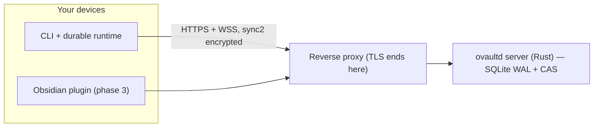

# ovaultd

Self-hosted, end-to-end encrypted file sync for Obsidian vaults. Your server, your keys: the server stores opaque, encrypted blobs and never sees what is inside them.

Functional parity with Obsidian Sync on infrastructure you own, built around a frozen wire spec (`v2`) and a crypto protocol (`sync2`) that was verified byte-for-byte between Rust and JavaScript before either side shipped. Design notes, ADRs and code comments are in Spanish; this README is the English entry point.

## Status

Early-stage, but the risky parts are done and tested.

| Phase | State |
|---|---|
| 0.1 — crypto spike (`sync1`) | historical, superseded |
| 0.2 — crypto gateway `sync2` + build plan | **closed** — `INTEROP sync2 OK` (byte-exact Rust ⇄ JS) |
| 1 — server MVP + CLI | functionally complete (arm64 image pending) |
| 2 — durable offline core (state, outbox, apply journal) | in progress — state, save-first outbox, apply journal and a real Chromium runtime that pulls signed deltas |
| 3 — Obsidian plugin | next, in its own repo |
| 4 — full E2E, key rotation, recovery | planned |
| 5 — conflicts, history, restore, preview | planned |

The parts marked done are backed by real-execution gates, not mocks: Rust unit and integration suites, TypeScript suites, browser durability specs against a real Chromium, a full server smoke test with live crypto and WebSocket traffic, an encrypted-scan canary over raw storage, and a container E2E that runs the entire flow through a real nginx.

## What it does

- Encrypted sync of vault files (add / modify / delete / move) with revisions and compare-and-swap (`expected_rev`), so racing edits become conflicts instead of silent data loss.
- Resumable uploads (a subset of tus) with per-account quotas; an interrupted transfer resumes from its last acknowledged offset.
- HTTP control plane plus a WebSocket data plane for revision deltas.
- A single hardened container: non-root uid, read-only rootfs, every capability dropped, SQLite WAL and a content-addressed blob store under `/data`.
- Reverse proxy first-class: the container E2E runs through the same nginx config that ships in `docker/proxy/nginx.conf.example`.
- No public registration. Accounts are created out-of-band with the admin CLI, which ships inside the image (ADR-0011).

## How it works



The server persists encrypted blobs, signed revision records and account metadata. Your keys are derived from your password and recovery key, and they never leave your devices. Revision records are signed by device keys and chained by `expected_rev`, so tampering is detectable by clients.

| Path | What it is |
|---|---|
| `crates/ovaultd-server` | the server (axum, tokio, sqlx; migrations embedded in the binary) |
| `crates/ovaultd-crypto` | Rust implementation of `sync2`, used in tests and the interop spike |
| `crates/ovaultd-protocol` | wire types shared by both sides |
| `packages/protocol` | the wire contract in TypeScript (types, strict base64, canonical serialization) |
| `packages/crypto` | `sync2` in TypeScript, a byte-faithful port of the spike |
| `packages/core` | durable client core: versioned IndexedDB state, save-first outbox, apply journal, sync session (WS + HTTP) and pull reconcile |
| `packages/cli` | `login`, `create-remote`, `setup`, `list-remote`, `status`, plus the durable Chromium runtime |
| `spikes/crypto-interop` | the Rust ⇄ JS interop spike and the golden-vector freeze tooling |
| `tests/` | browser specs, frozen fixtures, smoke / canary / container-E2E scripts |
| `docs/` | protocol and crypto specs, ADRs, deploy guide, build plan |
| `xtask/` | repo tasks (`cargo xtask protocol-check`) |

## Security model

Everything that matters happens on your device.

- Your password is stretched with Argon2id into a KEK, and the vault key is wrapped with it (and with a recovery key that is shown exactly once).
- Content is encrypted with XChaCha20-Poly1305 under per-vault, per-content keys. The nonce is derived from the plaintext and travels inside the stored blob, so the client can decrypt it later without the server's help (ADR-0014).
- Blob IDs are SHA-256 of the stored (encrypted) bytes. Identical content deduplicates inside a vault, and because the nonce derivation is keyed, deduplication is not an external oracle.
- Paths are encrypted as well; the server keeps them as opaque IDs plus ciphertext.
- Revision records are signed (Ed25519) and chained by `expected_rev`.

What the server can see: account email, device names, revision numbers, blob sizes and hashes, timing metadata. What it cannot see: file contents, file paths, keys, your password. Details in `docs/crypto.md` and `docs/decisions/`.

## Quickstart

### 1. Run the server

```bash
git clone https://github.com/kastormdz/ovaultd && cd ovaultd
cp .env.example .env

# builds the image locally and puts an example nginx in front
docker compose -f compose.yaml -f docker/compose.dev.yaml up -d --build

curl --fail http://127.0.0.1:8080/healthz   # server, direct
curl --fail http://127.0.0.1:8888/healthz   # through the example proxy
```

To run a published image later, set `OVAULTD_IMAGE` to a real `repository@sha256:...` digest and drop the dev overlay: `docker compose -f compose.yaml up -d`.

### 2. Create your account

Accounts are not self-service (ADR-0011); the admin tool ships inside the image:

```bash
printf '%s\n' 'a-long-password' | docker compose exec -T ovaultd \
  ovaultd-admin create-account --email you@example.com
```

The password is always read from stdin, never passed as an argument. `ovaultd-admin` also answers `health` and `inspect` without ever decrypting anything.

### 3. First vault, from the CLI

```bash
npm install
npm run build

printf '%s\n' 'a-long-password' | node packages/cli/dist/main.js \
  login http://127.0.0.1:8080 --email you@example.com --password-stdin

node packages/cli/dist/main.js create-remote my-vault
# prints the recovery key ONCE — store it somewhere safe.
# For scripts: --recovery-out <file> writes it 0600 instead.

node packages/cli/dist/main.js status
```

`create-remote` generates the vault material. `setup` links a local folder to an existing remote vault and checks your password against the material. `list-remote` shows what the account owns.

## Behind a reverse proxy

The container publishes on loopback and speaks plain HTTP; TLS belongs to the proxy. Three things a proxy has to get right (examples for nginx, Nginx Proxy Manager and Caddy in `docs/deploy.md`):

1. **Preserve `Host`.** Clients learn the server host from `POST /access`; a rewritten Host makes them store an unreachable URL.
2. **Allow WebSocket upgrades** on `/api/v1/ws`, with long read timeouts.
3. **Raise the body limit to 40 MB and disable request buffering.** Resumable upload blocks go up to 32 MiB, and the nginx default of 1 MB kills them with a 413.

## Development

```bash
npm install
npm run build            # TS packages + the core runtime bundle
npm test                 # TS suites (crypto vectors, wire conformance, CLI)
npm run test:browser     # durability specs against a real Chromium
cargo test --workspace   # Rust suites
cargo xtask protocol-check          # the SAME conformance fixture, both sides
bash tests/scripts/server-smoke.sh  # full server flow, live crypto + WebSocket
bash tests/scripts/scan-canary.sh   # no plaintext anywhere in server storage
bash tests/scripts/container-e2e.sh # everything, through a real nginx
(cd spikes/crypto-interop && ./run.sh --check)   # interop against frozen vectors
```

Rules worth knowing:

- The spec is frozen before code. Protocol or crypto changes land as a new ADR, never as a silent edit.
- Golden vectors are regenerated only through the sanctioned freeze path (`run.sh --freeze`), after review, and never in CI. The protocol conformance fixture is executed by both Rust and TS; that is the anti-drift gate.
- `scripts/scan-leaks.sh` checks the repo for accidentally committed infrastructure details and credentials, in the worktree and in history. Personal patterns (your hostnames, users, subnets) go in the gitignored `scripts/leaks.local` — see `scripts/leaks.local.example`. Wire it as a pre-commit hook with `git config core.hooksPath .githooks`.

## Docs

- `docs/protocol.md` — wire protocol v2 (control, data plane, algorithms)
- `docs/crypto.md` — the `sync2` crypto spec and golden vectors
- `docs/server-interfaces.md` — the server contract
- `docs/deploy.md` — Docker and reverse proxy, backups
- `docs/decisions/` — ADRs 0001–0014
- `docs/build-plan.md` — the construction plan, phase by phase
- `docs/reviews/` — three independent external review rounds from phase 0

## License

The server and Rust crates are licensed under AGPL-3.0 (`LICENSE`). The TypeScript packages under `packages/` are MIT, and each one ships its own `LICENSE`. The Obsidian plugin will be MIT as well, in its own repository.
